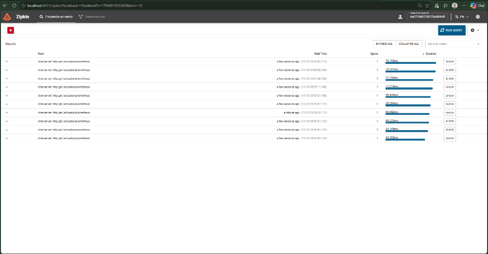
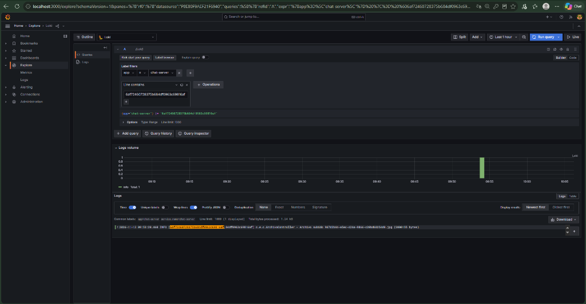

# 🎮 Chat en Vivo · Servidor Backend (`chat-server`)
> **DOSW 1 · Semana 15 · WebSockets, STOMP y Observabilidad de Producción**  
> **Estudiante:** Santiago Andrés García Almario  
> **Repositorio Frontend:** [chat-client](https://github.com/SantiagoAndresGarciaAlmario01/chat-client)

---

## 📌 1. Descripción del Servicio

`chat-server` es el núcleo backend de la plataforma de mensajería en tiempo real con temática **Lobby Gamer (NEXUS COMMS)**. Está construido con **Java 21** y **Spring Boot 3.4.2**, implementando comunicación bidireccional de baja latencia mediante **WebSockets** y el sub-protocolo **STOMP**.

Además de la mensajería síncrona en tiempo real, el backend implementa una arquitectura completa de **Observabilidad basada en los tres pilares**:
* 📊 **Métricas de Negocio e Infraestructura:** Expuestas vía Spring Boot Actuator y recolectadas por **Prometheus**.
* 🔍 **Trazabilidad Distribuida:** Correlación de peticiones HTTP con **Micrometer Tracing (Brave)** y exportación a **Zipkin**.
* 📜 **Centralización de Logs:** Envío estructurado de logs a **Grafana Loki** con inyección dinámica de `[traceId, spanId]`.

---

## 🏗️ 2. Arquitectura y Conexión entre Repositorios

El frontend (`chat-client`) y el backend (`chat-server`) interactúan mediante dos canales complementarios:
1. **Canal WebSocket Duplex (`ws://localhost:8080/ws`):** Se realiza el Handshake HTTP inicial que conmuta mediante el código de estado `101 Switching Protocols` a un canal TCP persistente sobre el que viajan los frames STOMP (`CONNECT`, `SUBSCRIBE`, `SEND`, `MESSAGE`).
2. **Canal REST Multipart (`http://localhost:8080/api/archivos`):** Maneja la subida de capturas de pantalla/imágenes pesadas para no degradar el ancho de banda del socket WebSocket.

```
       ┌────────────────────────┐                   ┌────────────────────────┐
       │      chat-client       │                   │      chat-server       │
       │     (React + Vite)     │                   │  (Spring Boot + STOMP) │
       └───────────┬────────────┘                   └───────────┬────────────┘
                   │                                            │
                   │─── 1. HTTP GET /ws (Upgrade: websocket) ──▶│
                   │◀── 2. HTTP 101 Switching Protocols ────────│
                   │                                            │
                   │─── 3. STOMP CONNECT / SUBSCRIBE ──────────▶│
                   │◀── 4. STOMP CONNECTED ─────────────────────│
                   │                                            │
                   │─── 5. STOMP SEND /app/chat.enviar ────────▶│
                   │◀── 6. STOMP MESSAGE /topic/sala ───────────│
                   │                                            │
                   │─── 7. HTTP POST /api/archivos (Imagen) ───▶│ (Genera traceId)
                   │◀── 8. JSON { "url": "/api/archivos/..." } ─│
                   │                                            │
                   ▼                                            ▼
```

---

## 📡 3. Destinos STOMP y Endpoints

### A. Destinos de Aplicación (El Cliente envía a `/app/...`)
| Destino STOMP | Controlador | Descripción |
| :--- | :--- | :--- |
| `/app/chat.unirse` | `ChatController.unirse()` | Registra al jugador en la sesión, suma al Gauge de conectados y difunde la entrada a la sala. |
| `/app/chat.enviar` | `ChatController.enviar()` | Recibe mensajes (`TEXTO`, `IMAGEN`, etc.), estampa la hora y los envía a la sala. |
| `/app/chat.escribiendo`| `ChatController.escribiendo()` | Difunde qué jugador está tecleando en el chat para el indicador animado. |

### B. Destinos del Broker (El Cliente se suscribe a `/topic/...`)
| Destino STOMP | Tipo de Contenido | Función |
| :--- | :--- | :--- |
| `/topic/sala` | `ChatMessage` (JSON) | Recibe los mensajes de todos los jugadores y eventos del sistema (`UNION`, `SALIDA`). |
| `/topic/escribiendo` | `String` (GamerTag) | Recibe en tiempo real el apodo del jugador que está escribiendo. |

### C. Endpoints REST
* `POST /api/archivos`: Recibe un `MultipartFile` (hasta 5MB), lo almacena localmente en `/uploads` y retorna la URL pública del archivo.
* `GET /api/archivos/{nombre}`: Sirve el archivo binario almacenado con su `Content-Type` correspondiente.
* `GET /actuator/prometheus`: Expone las métricas para el scraping de Prometheus.

---

## 🚀 4. Guía de Ejecución en Local Paso a Paso

### Prerrequisitos:
* **Java 21** LTS instalado.
* **Maven 3.9+** instalado.
* **Docker Desktop** activo.

### Pasos:

1. **Clonar el repositorio:**
   ```bash
   git clone https://github.com/SantiagoAndresGarciaAlmario01/chat-server.git
   cd chat-server
   ```

2. **Levantar el Stack de Observabilidad con Docker:**
   ```bash
   cd observabilidad
   docker compose up -d
   cd ..
   ```
   *Esto iniciará Prometheus (:9090), Loki (:3100), Zipkin (:9411) y Grafana (:3000).*

3. **Compilar y arrancar el servidor Spring Boot:**
   ```bash
   mvn spring-boot:run
   ```
   *El servidor quedará escuchando en `http://localhost:8080`.*

---

## 📊 5. Observabilidad y Monitoreo

### Métricas de Negocio Creadas (`ChatMetrics.java`):
* `chat_usuarios_conectados` (*Gauge*): Rastrea el número exacto de jugadores en el lobby en tiempo real. Se incrementa al invocar `entra()` y se decrementa automáticamente mediante `PresenciaListener` con el evento `SessionDisconnectEvent`.
* `chat_mensajes_total` (*Counter* con etiqueta `tipo`): Contabiliza el volumen de mensajes clasificados por `tipo` (`TEXTO`, `IMAGEN`, etc.).

### Tablero de Grafana (`dashboard-chat.json`):
El tablero está disponible en `http://localhost:3000` (*admin/admin*) con 6 paneles clave:
1. **Usuarios Conectados (En vivo):** Stat panel con alerta de color según afluencia.
2. **Mensajes por Minuto por Tipo:** Gráfica de series de tiempo basada en `rate(chat_mensajes_total[1m]) * 60`.
3. **Memoria JVM Heap Usada:** Monitoreo del consumo de memoria de la máquina virtual.
4. **Latencia p95 al Subir Archivos:** Histograma percentil 95 (`histogram_quantile`) de `/api/archivos`.
5. **Solo Errores (Loki):** Stream de logs filtrado por `level="ERROR"`.
6. **Logs Centralizados del Chat (Loki Stream):** Logs completos de la aplicación en vivo con `[traceId, spanId]`.

---

## 📸 6. Evidencias del Sistema en Funcionamiento

### A. Consola del Servidor (Handshake, Presencia y Mensajería)


### B. Tablero de Grafana en Vivo (Métricas, Memoria, Usuarios y Logs Stream)


### C. Trazabilidad en Zipkin (Búsqueda por traceId de Subida de Archivos)


### D. Correlación Cruzada en Loki (Filtro por traceId exacto)


---

## 💡 7. Preguntas de Reflexión Técnica

### 1. ¿Por qué un chat con HTTP normal tendría que estar preguntándole al servidor cada segundo, y qué cambia con WebSocket?
Con el protocolo HTTP tradicional (modelo solicitud/respuesta unidireccional), el servidor no tiene una vía nativa para empujar datos al navegador si este no los solicita primero. Por ello, una solución basada en HTTP requeriría **Short Polling** (hacer peticiones `GET` cada 1-2 segundos) o **Long Polling**, lo que genera una sobrecarga computacional y de red masiva: millones de cabeceras HTTP repetidas, apertura y cierre constante de conexiones TCP, congestión de red y una latencia perceptible.  
**WebSocket** cambia radicalmente este paradigma: tras una negociación inicial de Handshake (HTTP 101), la conexión muta a un canal de transporte TCP de doble vía (*full-duplex*) persistente. Ambas partes pueden enviar tramas binarias o de texto livianas (frames) con un overhead de apenas 2 a 10 bytes por mensaje, logrando latencias inferiores a 20 ms.

### 2. ¿Por qué las imágenes y los audios se suben por HTTP y no viajan dentro del WebSocket?
Los sockets WebSocket y los brokers de mensajería como STOMP están optimizados para el enrutamiento de mensajes cortos, rápidos y frecuentes en memoria (control, presencia, texto plano, notificaciones). Si transmitiéramos archivos binarios pesados (imágenes o notas de voz de 2 a 5 MB codificadas en Base64 o binario) por el mismo canal WebSocket:
1. Saturaríamos el búfer de entrada/salida del socket del cliente y del servidor.
2. Bloquearíamos el hilo de procesamiento del broker STOMP, retrasando la entrega de los mensajes de texto de todos los demás participantes.
3. El encoding Base64 aumenta el peso del payload en un 33%.  
Por ello, la mejor práctica de arquitectura es **híbrida**: el binario pesado se transmite por un canal HTTP `multipart/form-data` diseñado para streaming de archivos, y por el WebSocket únicamente se difunde el mensaje liviano con la URL resultante.

### 3. Si el servidor se reinicia, ¿qué pasa con los usuarios conectados y qué hace `reconnectDelay`?
Al reiniciarse el servidor, todas las conexiones de socket TCP subyacentes se cierran abruptamente. En el cliente, el evento `onWebSocketClose` se dispara de inmediato. La propiedad `reconnectDelay: 3000` de la librería `@stomp/stompjs` implementa una estrategia de reconexión automática resiliente: en lugar de fallar y requerir que el usuario recargue manualmente la página, el cliente espera 3000 ms (3 segundos) e intenta reestablecer el Handshake con el servidor de manera cíclica hasta que este vuelva a estar en línea.

### 4. ¿Qué métrica te avisaría primero de que el chat está fallando, y qué alerta pondrías sobre ella?
La métrica más temprana y crítica es **`chat_usuarios_conectados`** en conjunto con la tasa de errores de conexión o la tasa de desconexiones anómalas (`SessionDisconnectEvent`). Si en una ventana de 1 minuto `chat_usuarios_conectados` cae súbitamente en un 80% o llega a 0 mientras el tráfico entrante se mantiene, indica una caída del broker STOMP o saturación del socket server.  
**Regla de alerta recomendada en Prometheus/Grafana:**
```promql
rate(http_server_requests_seconds_count{status=~"5.."}[1m]) > 0.05
```
O una alerta sobre el broker STOMP:
```promql
deriv(chat_usuarios_conectados[2m]) < -5
```
Disparando una notificación crítica a Slack/PagerDuty si la caída no responde a una ventana de mantenimiento.

### 5. En Style Radar, ¿qué servicio se beneficiaría de WebSockets y qué tablero le armarías a cada microservicio?
* **Servicio beneficiado:** El servicio de **Alertas y Notificaciones de Tendencias en Vivo / Subastas de Prendas**: Si un usuario está viendo un radar de ofertas o el precio de un artículo cambia en tiempo real, un canal WebSocket evitaría que el cliente tenga que refrescar la pantalla para ver el stock actualizado o la nueva postura de oferta.
* **Tableros para los microservicios:**
  * **Microservicio de Autenticación / Usuarios:** Tablero centrado en tasa de login por minuto, ratio de fallos 401/403, tiempo de emisión de JWT y latencia de base de datos.
  * **Microservicio de Catálogo / Tendencias:** Tablero de latencia p95/p99 de búsqueda, tasa de aciertos de caché (Redis hit-ratio) y volumen de peticiones por endpoint.
  * **Microservicio de Pagos / Compras:** Tablero crítico de transacciones por segundo (TPS), tasa de carritos abandonados vs completados, tasa de errores 5xx de pasarelas de pago y trazas distribuidas con Zipkin para auditar cada transacción de punta a punta.

---

## 👥 Autores y Entrega
* **Estudiante:** Santiago Andrés García Almario
* **Materia:** DOSW 1 · Semana 15
* **Entrega:** Repositorio público de GitHub vinculado con Microsoft Teams.
