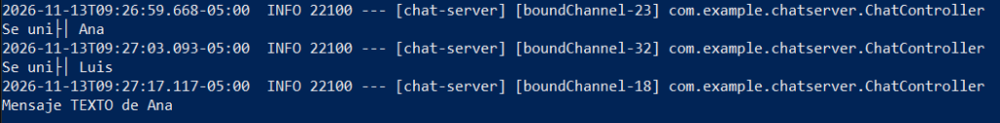
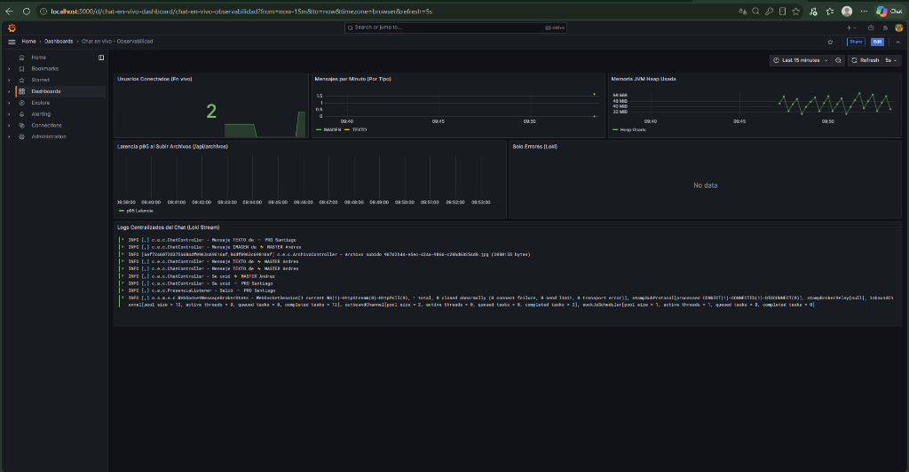

# Chat en Vivo - Servidor Backend (chat-server)
> **DOSW 1 - Semana 15 - WebSockets, STOMP y Observabilidad de Produccion**  
> **Estudiante:** Santiago Andres Garcia Almario  
> **Repositorio Frontend:** [chat-client](https://github.com/SantiagoAndresGarciaAlmario01/chat-client)

---

## 1. Descripcion del Servicio

chat-server es el nucleo backend de la plataforma de mensajeria en tiempo real con tematica Lobby Gamer (NEXUS COMMS). Esta construido con Java 21 y Spring Boot 3.4.2, implementando comunicacion bidireccional de baja latencia mediante WebSockets y el subprotocolo STOMP.

Ademas de la mensajeria sincrona en tiempo real, el backend implementa una arquitectura completa de Observabilidad basada en los tres pilares:
* **Metricas de Negocio e Infraestructura:** Expuestas via Spring Boot Actuator y recolectadas periodicamente por Prometheus.
* **Trazabilidad Distribuida:** Correlacion de peticiones HTTP con Micrometer Tracing (Brave) y exportacion hacia Zipkin.
* **Centralizacion de Logs:** Envio estructurado de logs a Grafana Loki con inyeccion dinamica de traceId y spanId.

---

## 2. Arquitectura y Conexion entre Repositorios

El frontend (chat-client) y el backend (chat-server) interactuan mediante dos canales complementarios:
1. **Canal WebSocket Duplex (ws://localhost:8080/ws):** Se realiza el Handshake HTTP inicial que conmuta mediante el codigo de estado 101 Switching Protocols a un canal TCP persistente sobre el que viajan los frames STOMP (CONNECT, SUBSCRIBE, SEND, MESSAGE).
2. **Canal REST Multipart (http://localhost:8080/api/archivos):** Maneja la subida de capturas de pantalla e imagenes pesadas para no degradar el rendimiento ni saturar el socket WebSocket.

```
       +------------------------+                   +------------------------+
       |      chat-client       |                   |      chat-server       |
       |     (React + Vite)     |                   |  (Spring Boot + STOMP) |
       +-----------+------------+                   +-----------+------------+
                   |                                            |
                   |--- 1. HTTP GET /ws (Upgrade: websocket) -->|
                   |<-- 2. HTTP 101 Switching Protocols --------|
                   |                                            |
                   |--- 3. STOMP CONNECT / SUBSCRIBE ---------->|
                   |<-- 4. STOMP CONNECTED ---------------------|
                   |                                            |
                   |--- 5. STOMP SEND /app/chat.enviar -------->|
                   |<-- 6. STOMP MESSAGE /topic/sala -----------|
                   |                                            |
                   |--- 7. HTTP POST /api/archivos (Imagen) --->| (Genera traceId)
                   |<-- 8. JSON { "url": "/api/archivos/..." } -|
                   |                                            |
                   v                                            v
```

---

## 3. Destinos STOMP y Endpoints

### A. Destinos de Aplicacion (El Cliente envia a /app/...)
| Destino STOMP | Controlador | Descripcion |
| :--- | :--- | :--- |
| `/app/chat.unirse` | `ChatController.unirse()` | Registra al jugador en la sesion, suma al Gauge de conectados y difunde la entrada a la sala. |
| `/app/chat.enviar` | `ChatController.enviar()` | Recibe mensajes (TEXTO, IMAGEN, etc.), estampa la hora y los envia a la sala. |
| `/app/chat.escribiendo`| `ChatController.escribiendo()` | Difunde que jugador esta tecleando en el chat para el indicador animado. |

### B. Destinos del Broker (El Cliente se suscribe a /topic/...)
| Destino STOMP | Tipo de Contenido | Funcion |
| :--- | :--- | :--- |
| `/topic/sala` | `ChatMessage` (JSON) | Recibe los mensajes de todos los jugadores y eventos del sistema (UNION, SALIDA). |
| `/topic/escribiendo` | `String` (GamerTag) | Recibe en tiempo real el apodo del jugador que esta escribiendo. |

### C. Endpoints REST
* `POST /api/archivos`: Recibe un MultipartFile (hasta 5MB), lo almacena localmente en `/uploads` y retorna la URL publica del archivo.
* `GET /api/archivos/{nombre}`: Sirve el archivo binario almacenado con su Content-Type correspondiente.
* `GET /actuator/prometheus`: Expone las metricas para el scraping de Prometheus.

---

## 4. Guia de Ejecucion en Local Paso a Paso

### Prerrequisitos:
* Java 21 LTS instalado.
* Maven 3.9+ instalado.
* Docker Desktop activo.

### Pasos:

1. **Clonar el repositorio:**
   ```bash
   git clone https://github.com/SantiagoAndresGarciaAlmario01/chat-server.git
   cd chat-server
   ```

2. **Levantar el Stack de Observabilidad con Docker:**
   ```bash
   cd observabilidad
   docker compose up -d
   cd ..
   ```
   *Esto iniciara Prometheus (:9090), Loki (:3100), Zipkin (:9411) y Grafana (:3000).*

3. **Compilar y arrancar el servidor Spring Boot:**
   ```bash
   mvn spring-boot:run
   ```
   *El servidor quedara escuchando en http://localhost:8080.*

---

## 5. Observabilidad y Monitoreo

### Metricas de Negocio Creadas (ChatMetrics.java):
* `chat_usuarios_conectados` (Gauge): Rastrea el numero exacto de jugadores en el lobby en tiempo real. Se incrementa al invocar `entra()` y se decrementa automaticamente mediante `PresenciaListener` con el evento `SessionDisconnectEvent`.
* `chat_mensajes_total` (Counter con etiqueta `tipo`): Contabiliza el volumen de mensajes clasificados por tipo (TEXTO, IMAGEN, etc.).

### Tablero de Grafana (dashboard-chat.json):
El tablero esta disponible en http://localhost:3000 (admin/admin) con 6 paneles clave:
1. **Usuarios Conectados (En vivo):** Stat panel con alerta de color segun afluencia.
2. **Mensajes por Minuto por Tipo:** Grafica de series de tiempo basada en `rate(chat_mensajes_total[1m]) * 60`.
3. **Memoria JVM Heap Usada:** Monitoreo del consumo de memoria de la maquina virtual.
4. **Latencia p95 al Subir Archivos:** Histograma percentil 95 (`histogram_quantile`) de `/api/archivos`.
5. **Solo Errores (Loki):** Stream de logs filtrado por `level="ERROR"`.
6. **Logs Centralizados del Chat (Loki Stream):** Logs completos de la aplicacion en vivo correlacionados con traceId y spanId.

---

## 6. Evidencias del Sistema en Funcionamiento

### A. Consola del Servidor (Handshake, Presencia y Mensajeria)


### B. Tablero de Grafana en Vivo (Metricas, Memoria, Usuarios y Logs Stream)


### C. Trazabilidad en Zipkin (Busqueda por traceId de Subida de Archivos)


### D. Correlacion Cruzada en Loki (Filtro por traceId exacto)


---

## 7. Preguntas de Reflexion Tecnica

### 1. Por que un chat con HTTP normal tendria que estar preguntandole al servidor cada segundo, y que cambia con WebSocket?
Con el protocolo HTTP tradicional (modelo solicitud/respuesta unidireccional), el servidor no tiene una via nativa para empujar datos al navegador si este no los solicita primero. Por ello, una solucion basada en HTTP requeriria Short Polling (hacer peticiones GET cada 1-2 segundos) o Long Polling, lo que genera una sobrecarga computacional y de red masiva: millones de cabeceras HTTP repetidas, apertura y cierre constante de conexiones TCP, congestion de red y una latencia perceptible.  
WebSocket cambia radicalmente este paradigma: tras una negociacion inicial de Handshake (HTTP 101), la conexion muta a un canal de transporte TCP de doble via (full-duplex) persistente. Ambas partes pueden enviar tramas binarias o de texto livianas (frames) con un overhead de apenas 2 a 10 bytes por mensaje, logrando latencias inferiores a 20 ms.

### 2. Por que las imagenes y los audios se suben por HTTP y no viajan dentro del WebSocket?
Los sockets WebSocket y los brokers de mensajeria como STOMP estan optimizados para el enrutamiento de mensajes cortos, rapidos y frecuentes en memoria (control, presencia, texto plano, notificaciones). Si transmitiramos archivos binarios pesados (imagenes o notas de voz de 2 a 5 MB codificadas en Base64 o binario) por el mismo canal WebSocket:
1. Saturariamos el buffer de entrada y salida del socket del cliente y del servidor.
2. Bloqueariamos el hilo de procesamiento del broker STOMP, retrasando la entrega de los mensajes de texto de todos los demas participantes.
3. La codificacion Base64 aumenta el tamano del payload en un 33%.  
Por ello, la mejor practica de arquitectura es hibrida: el binario pesado se transmite por un canal HTTP multipart/form-data disenado para streaming de archivos, y por el WebSocket unicamente se difunde el mensaje liviano con la URL resultante.

### 3. Si el servidor se reinicia, que pasa con los usuarios conectados y que hace reconnectDelay?
Al reiniciarse el servidor, todas las conexiones de socket TCP subyacentes se cierran abruptamente. En el cliente, el evento onWebSocketClose se dispara de inmediato. La propiedad `reconnectDelay: 3000` de la libreria `@stomp/stompjs` implementa una estrategia de reconexion automatica resiliente: en lugar de fallar y requerir que el usuario recargue manualmente la pagina, el cliente espera 3000 ms (3 segundos) e intenta reestablecer el Handshake con el servidor de manera ciclica hasta que este vuelva a estar en linea.

### 4. Que metrica te avisaria primero de que el chat esta fallando, y que alerta pondrias sobre ella?
La metrica mas temprana y critica es `chat_usuarios_conectados` en conjunto con la tasa de errores de conexion o la tasa de desconexiones anomalas (`SessionDisconnectEvent`). Si en una ventana de 1 minuto `chat_usuarios_conectados` cae subitamente en un 80% o llega a 0 mientras el trafico entrante se mantiene, indica una caida del broker STOMP o saturacion del socket server.  
Regla de alerta recomendada en Prometheus/Grafana:
```promql
rate(http_server_requests_seconds_count{status=~"5.."}[1m]) > 0.05
```
O una alerta sobre la tasa de caida del broker STOMP:
```promql
deriv(chat_usuarios_conectados[2m]) < -5
```
Disparando una notificacion critica si la caida no responde a una ventana de mantenimiento.

### 5. En Style Radar, que servicio se beneficiaria de WebSockets y que tablero le armarias a cada microservicio?
* **Servicio beneficiado:** El servicio de Alertas y Notificaciones de Tendencias en Vivo / Subastas de Prendas: Si un usuario esta viendo un radar de ofertas o el precio de un articulo cambia en tiempo real, un canal WebSocket evitaria que el cliente tenga que refrescar la pantalla para ver el stock actualizado o la nueva postura de oferta.
* **Tableros para los microservicios:**
  * **Microservicio de Autenticacion / Usuarios:** Tablero centrado en tasa de login por minuto, ratio de fallos 401/403, tiempo de emision de JWT y latencia de base de datos.
  * **Microservicio de Catalogo / Tendencias:** Tablero de latencia p95/p99 de busqueda, tasa de aciertos de cache (Redis hit-ratio) y volumen de peticiones por endpoint.
  * **Microservicio de Pagos / Compras:** Tablero critico de transacciones por segundo (TPS), tasa de carritos abandonados vs completados, tasa de errores 5xx de pasarelas de pago y trazas distribuidas con Zipkin para auditar cada transaccion de punta a punta.

---

## Autores y Entrega
* **Estudiante:** Santiago Andres Garcia Almario
* **Materia:** DOSW 1 - Semana 15
* **Entrega:** Repositorio publico de GitHub vinculado con Microsoft Teams.
